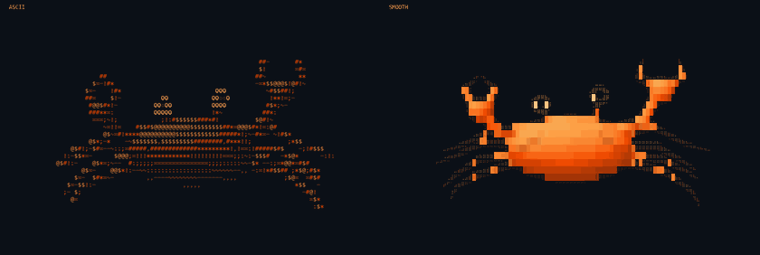

# Dancing Crab

A Rust-orange 3D crab drawn with symbols in your terminal. Choose classic shaded ASCII, in the style of the spinning donut, or a finer Unicode view. It scuttles from side to side, opens and closes its pincers, steps with its legs, and moves its eyes.



[ASCII preview](docs/preview.gif) · [Smooth preview](docs/preview-smooth.gif)

## Run

Install [Rust and Cargo](https://www.rust-lang.org/tools/install), then run:

```sh
git clone https://github.com/ANKITRA-J/dancing-crab.git
cd dancing-crab
cargo run --release
```

Use a terminal with a monospaced font and at least 21 columns × 10 rows. This leaves room for a 20×8 canvas, controls, and a spare column to prevent wrapping. The animation fits the terminal and responds to resizing.

ASCII is the default style. For finer edges and smaller details, start with `--style smooth` or press **M** while the animation runs. Smooth mode uses Unicode Braille characters, packing a 2×4 dot grid into each terminal cell. Use a font that supports those characters and a terminal configured for UTF-8.

| Key | Action |
| --- | --- |
| Space | Pause or resume |
| M | Switch between ASCII and smooth styles |
| Q, Esc, or Ctrl+C | Quit |

## Options

```sh
cargo run --release -- --help
cargo run --release -- --style smooth
cargo run --release -- --no-color
cargo run --release -- --width 100 --height 32 --frames 300
cargo run --release -- --snapshot --time 1.5 > crab.txt
cargo run --release -- --style smooth --snapshot > crab-smooth.txt
```

| Option | Meaning |
| --- | --- |
| `--style ascii\|smooth` | Display style; default `ascii` |
| `--snapshot` | Print one plain frame in the selected style and exit |
| `--no-color` | Disable orange coloring in either animation style |
| `--time SECONDS` | Animation time for the first frame; finite and nonnegative |
| `--width COLUMNS` | Canvas width, 20–400 characters |
| `--height ROWS` | Canvas height, 8–120 rows |
| `--fps FPS` | Frame rate, 1–120; default 60 |
| `--frames COUNT` | Stop after this many rendered frames; positive integer |
| `--help` | Show usage |

Both interactive styles use an orange palette by default. Colored smooth mode fills the shell's interior while fine Braille dots trace its edges; plain and monochrome smooth output uses Braille dots throughout. Pass `--no-color` or set the `NO_COLOR` environment variable to use monochrome symbols instead.

Snapshots and redirected or piped output are plain text in the selected style, without color or terminal control codes. The default style produces ASCII; smooth mode produces UTF-8 Unicode text. Redirected output prints a single frame by default. With `--frames N`, it prints N snapshots at `--fps` time increments, without delays between frames. Plain output defaults to a 100×32 canvas. During animation, requested dimensions are limited to the available terminal space; the controls sit outside the canvas.

## How it works

The crab is built from rounded 3D surfaces with articulated joints, a shell rim, and surface grooves. Each frame moves its limbs and finds where viewing rays meet those surfaces. A depth buffer keeps nearer surfaces visible, and the angle to a light source controls the shading. ASCII mode maps that shading to symbols; smooth mode renders a finer grid and combines it into Braille cells.

The renderer uses Rust's standard library. [crossterm](https://crates.io/crates/crossterm) handles terminal input, resizing, and screen restoration.

## Development

```sh
cargo fmt --check
cargo test
cargo clippy --all-targets -- -D warnings
```
