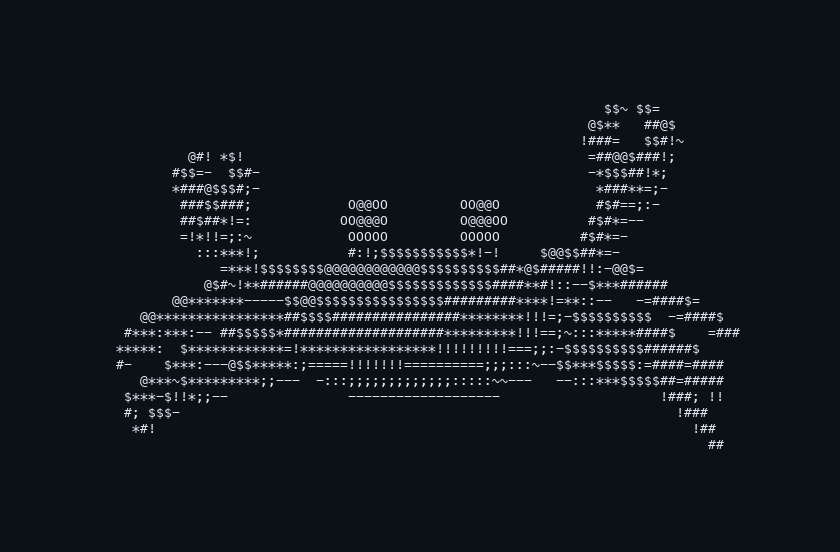

# Dancing Crab

A Rust-orange 3D crab drawn entirely with ASCII symbols in your terminal, in the style of the classic spinning donut. It scuttles from side to side, waves its pincers, steps with its legs, and moves its eyes. Characters and orange shades give its shell and limbs depth.



## Run

Install [Rust and Cargo](https://www.rust-lang.org/tools/install), then run:

```sh
git clone https://github.com/ANKITRA-J/dancing-crab.git
cd dancing-crab
cargo run --release
```

Use a terminal with a monospaced font and at least 21 columns × 10 rows. This leaves room for a 20×8 canvas, controls, and a spare column to prevent wrapping. The animation fits the terminal and responds to resizing.

| Key | Action |
| --- | --- |
| Space | Pause or resume |
| Q, Esc, or Ctrl+C | Quit |

## Options

```sh
cargo run --release -- --help
cargo run --release -- --fps 60
cargo run --release -- --no-color
cargo run --release -- --width 100 --height 32 --frames 300
cargo run --release -- --snapshot --time 1.5 > crab.txt
```

| Option | Meaning |
| --- | --- |
| `--snapshot` | Print one plain ASCII frame and exit |
| `--no-color` | Disable orange coloring during terminal animation |
| `--time SECONDS` | Animation time for the first frame; finite and nonnegative |
| `--width COLUMNS` | Canvas width, 20–400 characters |
| `--height ROWS` | Canvas height, 8–120 rows |
| `--fps FPS` | Frame rate, 1–120; default 30 |
| `--frames COUNT` | Stop after this many rendered frames; positive integer |
| `--help` | Show usage |

The interactive crab uses an orange palette by default. Pass `--no-color` or set the `NO_COLOR` environment variable to use monochrome symbols instead.

Snapshots and redirected or piped output are always plain ASCII, without color or terminal control codes. Redirected output prints a single frame by default. With `--frames N`, it prints N snapshots at `--fps` time increments, without delays between frames. Plain output defaults to a 100×32 canvas. During animation, requested dimensions are limited to the available terminal space; the controls sit outside the canvas.

## How it works

The crab is built from sampled 3D surfaces. Each frame moves its limbs, rotates the points and their surface normals, then projects the model onto a character grid. A depth buffer keeps nearer surfaces visible. The angle between each surface and a light source selects a symbol from a shading ramp, producing the donut-style lighting effect.

The renderer uses Rust's standard library. [crossterm](https://crates.io/crates/crossterm) handles terminal input, resizing, and screen restoration.

## Development

```sh
cargo fmt --check
cargo test
cargo clippy --all-targets -- -D warnings
```
